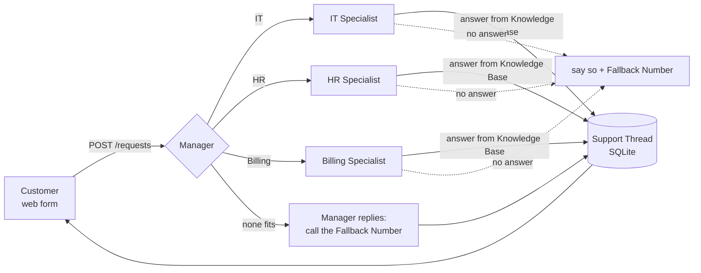

# Customer Support: a multi-agent system on AutoGen

Customers of a software company submit a **Support Request** through a web form. A **Manager** agent
works out what it is about and **delegates** it to one of three **Specialists** (IT, HR, Billing),
who answer from their own **Knowledge Base**. The Manager never answers the Customer, with one
exception: when no Specialist fits, it replies with a **Fallback Number** to call.

This is an assignment, so Knowledge Bases are small mock files and there are no real integrations.
Terms are defined in [`GLOSSARY.md`](GLOSSARY.md); the requirements are in
[issue #1](https://github.com/codaswin/customer_support/issues/1).

## How a request flows



| Specialist | Answers | Knowledge Base |
|------------|---------|----------------|
| IT | product and technical issues | `support/knowledge/IT.md` |
| HR | accounts and contracts (seats, ownership, terms) | `support/knowledge/HR.md` |
| Billing | money only (invoices, refunds, plan changes) | `support/knowledge/Billing.md` |

Rules the system enforces:

- A request that fits two domains goes to the **single best match**; it is never split.
- Follow-ups in a **Support Thread** stay with the same Specialist (no new Delegation).
- Specialists are **answer-only**: they take no actions. If their Knowledge Base has no answer they
  say so and give the Fallback Number instead of guessing.
- Threads are stored in SQLite, so they survive a restart, and are resumed by id (`/?thread=<id>`).
- Input is validated (name, email, message up to 2000 characters), and a thread holds at most 50
  messages with only the latest 20 sent to the model, which bounds model cost per anonymous user.

## Quick start

Needs Python 3.10+. No API key is needed: without one the app runs in **demo mode**, where a
keyword-based stand-in replaces the language model (`support/demo.py`).

```bash
python -m venv .venv && . .venv/bin/activate
pip install -e ".[dev]"

uvicorn support.main:app --port 8000     # then open http://localhost:8000
```

- Web form: <http://localhost:8000/>
- Interactive API docs: <http://localhost:8000/docs>
- Real model instead of demo mode: `pip install -e ".[openai]"` and set `OPENAI_API_KEY`
  (optionally `SUPPORT_MODEL`). `SUPPORT_DEMO=1` forces demo mode even when a key is set.

| Variable | Default | Purpose |
|----------|---------|---------|
| `OPENAI_API_KEY` | unset (demo mode) | enables the real model |
| `SUPPORT_MODEL` | `gpt-4o-mini` | model name for the real client |
| `SUPPORT_DB` | `support.db` | SQLite file for Support Threads |
| `SUPPORT_FALLBACK_NUMBER` | `+1-800-555-0100` | number given when no one can help |
| `SUPPORT_DEMO` | unset | force demo mode |

## Demo

`python examples/walkthrough.py` runs a scripted tour with no server (output below), and the web
form at `/` lets you try the same questions by hand: *"How do I get a refund?"*, *"My app crashes
on start"*, *"How do I add seats?"*, *"What is the weather today?"*.

```text
== IT: technical issue
   Customer: My app crashes on start, what should I do?
         IT: If the app crashes on start, reinstall it and clear its cache folder.

== HR: account and contract
   Customer: How do I add more seats to my team?
         HR: Seats can be added by an account owner from Settings > Team, up to the plan limit.

== Billing: money
   Customer: How do I get a refund?
    Billing: Refunds are available within 30 days of payment and are returned to the original payment method.

== Follow-up stays with the same Specialist (Billing)
   Customer: How do I change my plan?
    Billing: Plan changes take effect immediately and are prorated on the next invoice.

== No Specialist fits: the Manager gives the Fallback Number
   Customer: What is the weather today?
    Manager: Sorry, we can't help with that here. Please call +1-800-555-0100.

== Specialist has no answer: says so, gives the Fallback Number
   Customer: Which error colour theme exists?
         IT: I don't know the answer to that. Please call +1-800-555-0100.

== The Support Thread survives an app restart
  thread 925ea8a9... still has 4 messages after restart
```

## HTTP API

| Method and path | Purpose |
|-----------------|---------|
| `POST /requests` | submit `{name, email, message}`; returns `{thread_id, specialist, answer}` |
| `POST /threads/{id}/messages` | add a follow-up `{message}`; returns `{specialist, answer}` |
| `GET /threads/{id}` | read the whole Support Thread |
| `GET /` | the web form |

`specialist` is `null` when no Specialist fit. Errors: `422` invalid input, `404` unknown thread,
`429` thread is full.

## Project layout

```text
support/
  app.py         FastAPI app: endpoints, input models, reply wording, cost caps
  agents.py      AutoGen agents: Manager (delegate) and Specialists (answer)
  store.py       SQLite persistence for Support Threads
  demo.py        keyword-based stand-in for the language model (demo mode)
  main.py        ASGI entrypoint; picks the real or demo model
  knowledge/     one mock Knowledge Base per Specialist
  static/        the web form (single HTML file, no build step)
tests/           behaviour tests through the HTTP interface
examples/        walkthrough.py, the scripted demo
docs/adr/        architecture decisions
```

## Tests

```bash
pytest          # 28 tests
ruff check .    # lint
```

All tests go through the HTTP interface, the one agreed seam, and replace the language model with a
scripted fake (`ReplayChatCompletionClient`), so they are deterministic and use no network.
Nothing asserts on prompts or storage layout, except one check that each Specialist is given only
its own Knowledge Base, which is the only way to observe grounding with a fake model.

## Design decisions and limits

- **SQLite** for threads: see [ADR 0001](docs/adr/0001-sqlite-for-support-threads.md).
- **Protocol with the model:** the Manager replies with a single label (`IT`, `HR`, `Billing` or
  `NONE`) and a Specialist replies `UNKNOWN` when its Knowledge Base lacks the answer. Replies are
  matched ignoring case and punctuation; anything unrecognised is treated as no fit.
- **No authentication.** Anyone with a full thread link can read that thread; ids are random
  128-bit values. The name and email on the form are unverified labels.
- **A no-fit thread stays no-fit:** follow-ups are never re-delegated, so a Customer who wants to
  rephrase starts a new request.
- **Out of scope:** human handoff, agent actions (refunds, password resets), other channels,
  splitting a request across Specialists, an admin role.
